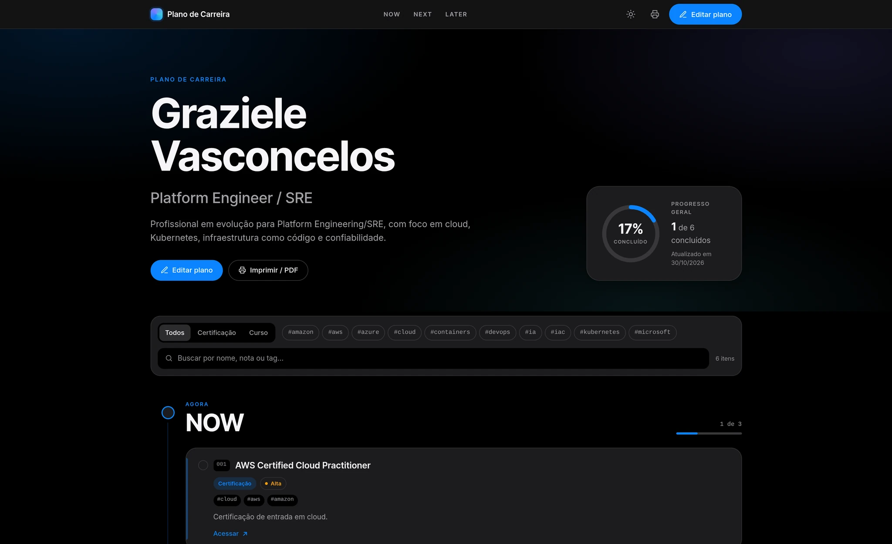

# career-path



Plano de carreira de **Graziele Vasconcelos**, construído com o framework
**NOW / NEXT / LATER** e publicado no GitHub Pages.

**Página:** https://grazielevasconcelos.github.io/career-path/

> **Vai editar o plano?** O passo a passo — campos, checklist e erros comuns —
> está em [`docs/edicao.md`](docs/edicao.md).

## Como funciona

O [`career.md`](career.md) é a única fonte de verdade. Um script em Python (somente biblioteca padrão) lê o Markdown e gera uma timeline estática em `dist/`. O GitHub Actions publica essa pasta no Pages a cada push na `main`.

```text
career.md  →  src/build.py  →  dist/  →  GitHub Actions  →  GitHub Pages
```

Os rótulos qualitativos indicam o estágio de cada raia, sem prazos fixos:

- `NOW`: Agora
- `NEXT`: Próximo
- `LATER`: Depois

A página é **somente leitura**: para marcar um item como concluído, edite o
`career.md` — o passo a passo está em [`docs/edicao.md`](docs/edicao.md). O botão
**Editar plano** abre o arquivo direto no editor do GitHub.

## Início rápido

Requisitos: Python 3.9+ e `make` (opcional).

```bash
make run
```

Abre em `http://127.0.0.1:8000`. O site é reconstruído ao salvar `career.md` ou os arquivos de `src/`.

Se a porta estiver ocupada, use `PORT=8001 make run`.

Sem `make`:

```bash
python3 src/build.py
python3 -m http.server -d dist 8000
```

Para validar sem subir servidor:

```bash
make test
```

Para rodar o preview em Docker ou Podman, consulte
[`docs/containers.md`](docs/containers.md).

## Publicação

O workflow [`.github/workflows/pages.yml`](.github/workflows/pages.yml) roda em todo push na `main` e também pode ser disparado manualmente.

Na primeira vez, ative o Pages em **Settings → Pages → Build and deployment → Source: GitHub Actions**.

Depois de qualquer edição:

```bash
git add career.md
git commit -m "Atualiza plano de carreira"
git push origin main
```

O site é atualizado em alguns minutos.

## Estrutura

```text
.
├── career.md                     # fonte única do plano
├── README.md
├── AGENTS.md                     # guia para agentes de código
├── assets/
│   └── banner-readme.webp        # capa exibida no README
├── docs/
│   ├── edicao.md                 # como editar o career.md
│   ├── containers.md             # preview em Docker/Podman
│   └── site.md                   # filtros, tema e impressão
├── Dockerfile                    # imagem de preview com hardening
├── docker-compose.yml            # preview local em container
├── .dockerignore
├── Makefile
├── src/
│   ├── build.py                  # parser + gerador estático
│   ├── check.py                  # validação do plano e do HTML
│   ├── watch.py                  # preview com rebuild automático
│   ├── template.html             # estrutura da página
│   ├── styles.css                # visual claro/escuro, timeline e impressão
│   ├── app.js                    # filtros, busca, tema e guia de impressão
│   ├── fonts/
│   │   ├── Inter-Variable.woff2  # fonte Inter empacotada localmente
│   │   └── OFL.txt               # licença SIL Open Font License
│   └── favicon.svg
└── .github/workflows/pages.yml
```

`dist/` é gerado localmente e no CI; não é versionado.

## Documentação

| Documento | Quando consultar |
|---|---|
| [`docs/edicao.md`](docs/edicao.md) | Editar o `career.md`, criar/concluir itens e entender erros |
| [`docs/containers.md`](docs/containers.md) | Rodar o preview em Docker/Podman, hardening e supply chain |
| [`docs/site.md`](docs/site.md) | Filtros, tema e impressão/PDF |
